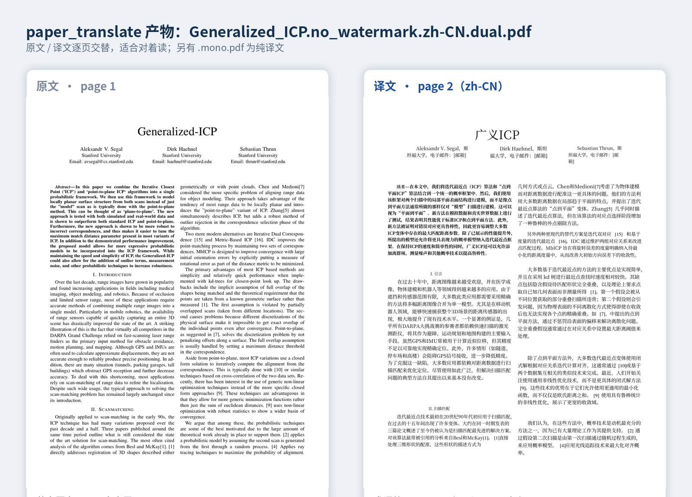
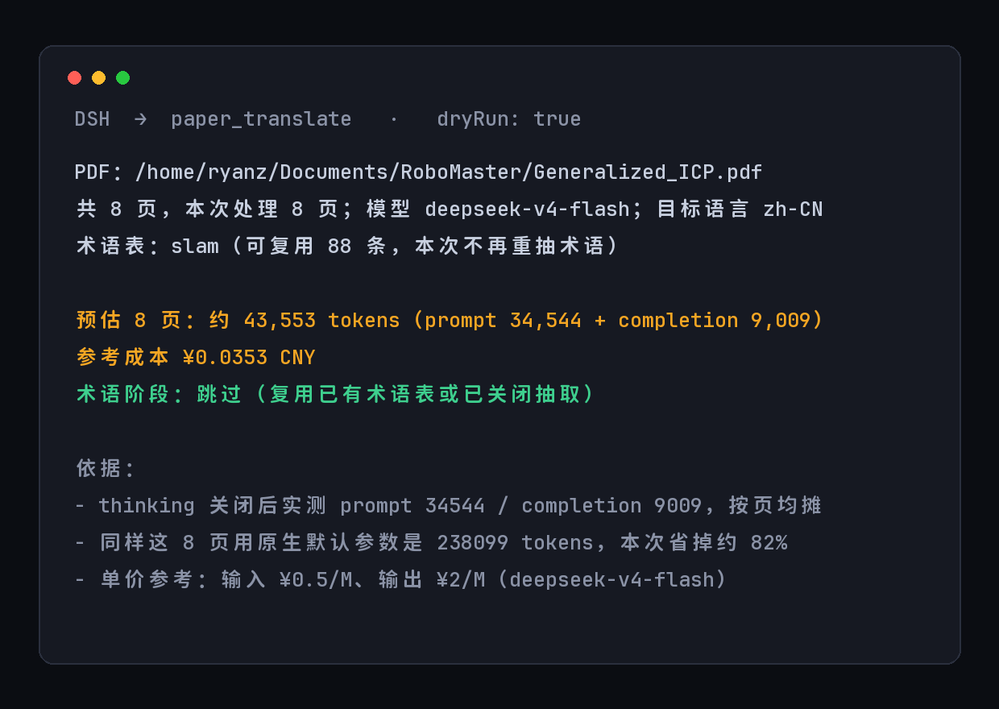

# dsh-paper-translate

[](https://github.com/RyanZhangK/dsh-paper-translate/actions/workflows/ci.yml)

> 把 [BabelDOC](https://github.com/funstory-ai/BabelDOC) 包成一个 DSH 工具：整篇 PDF 文献 → 中文双语对照版，**先报成本，再动手**。

它不重新发明翻译，只补掉直接用 BabelDOC 时会踩到的三个坑：不读自己的 config、服务端偷偷开 thinking、术语表每篇重抽一遍。

## ✨ 特性

- **先报成本再动手**：`dryRun: true` 直接给出这篇 PDF 要花多少 token、折合多少钱，不满意就不跑
- **关掉隐藏的推理开销**：固定传 `--openai-thinking disabled`，实测 completion 降 77%，译文长度几乎不变
- **术语表跨文档复用**：按 `domain` 存 `~/.local/share/dsh-paper-translate/glossary/<domain>.csv`，同领域第二篇论文直接复用，跑完还会把新增术语回填进去
- **环境自检**：缺 BabelDOC、config 缺 key、`bitstring` 版本不对，都把准确的修复命令交回来，而不是抛一堆 traceback
- **双语对照输出**：`.dual.pdf`（原文/译文交替）+ `.mono.pdf`（纯译文）
- **缓存透明**：命中 BabelDOC 本地翻译缓存时明确告诉你 0 token，想强制重翻传 `ignoreCache: true`

## 📸 预览





## 📦 安装

不发 npm，两种装法，都走 `dsh plugin`（它会同时写 `dependencies` 和 `dsh.profile.bundles`）：

```bash
# A. 直接从 GitHub 装（推荐，一条命令）
dsh plugin --profile web add github:RyanZhangK/dsh-paper-translate

# B. 本地 clone + link（要改代码时用）
git clone https://github.com/RyanZhangK/dsh-paper-translate.git
dsh plugin --profile web add link:/绝对路径/dsh-paper-translate
```

安装后重启 `dsh web` 即可使用，不需要额外配置。

> 不用自己 `npm install`。`@deepseek-ai/cordis` 和 `@deepseek-ai/dsh-tools` 是 **optional peer**，运行时由 DSH 宿主解析（`dsh-app-boot` 的 `HostResolvedRootInclude.import()` 把 bare specifier 指到宿主安装目录），所以插件目录里没有 `node_modules` 也能跑。
>
> 这两个 peer 必须写真实版本范围并标 `"optional": true`。写成 `"*"` 时 pnpm 会去 registry 找满足 `*` 的 `@deepseek-ai/dsh-tools`（只有 `0.0.1-rc.1`），而它依赖的 `@deepseek-ai/dsh-type-meta` 从没发布过，安装会以 `ERR_PNPM_FETCH_404` 失败。

> ⚠️ 只往 `~/.dsh/profiles/<profile>/package.json` 的 `dependencies` 里加一行、再 `npm install`，**插件不会生效**。DSH 启动时只加载 `dsh.profile.bundles` 里列出的包（`dsh-app-boot` 的 `loadProfileDirectory()`），那个数组是 `dsh plugin add` 才会帮你补的。
>
> 确实要手工装，两个地方都得改：`dependencies` 加 `"dsh-paper-translate": "github:RyanZhangK/dsh-paper-translate"`，**并且**把它追加进 `dsh.profile.bundles` 数组。

要调并发等参数，在 profile 的 `cordis.patch.yml` 里给 `paper-translate` 这一行加 `config`（见本仓库 [`cordis.patch.yml`](./cordis.patch.yml) 的注释）。

## 🎯 使用

工具名 `paper_translate`，参数：

| 参数 | 说明 |
| --- | --- |
| `pdf` | 必填，PDF **绝对路径**（工具进程的 cwd 不是你的 shell 目录，相对路径会解析到别处，插件直接拒绝） |
| `domain` | 术语库领域，如 `slam` / `rl` / `cv`，默认 `general`。同领域论文共用一份术语表 |
| `pages` | 只翻部分页，如 `1-6` 或 `1,3,7-9` |
| `extractGlossary` | 是否允许现场抽取术语。默认 `true`，但**只有该领域还没有可用词表时才会真的抽**——BabelDOC 一旦抽词就会把 `--glossary-files` 的用户词表整个丢弃（`get_glossaries_for_translation()` 直接 return 自动词表），两者互斥。传 `false` 表示只复用词表、不花钱抽新词 |
| `langOut` | 目标语言，默认沿用 config 的 `lang-out` |
| `outputDir` | 输出目录，默认沿用 config 的 `output` |
| `dryRun` | 只做环境检查 + 成本预估，不启动翻译 |
| `ignoreCache` | 忽略 BabelDOC 的翻译缓存强制重翻。默认复用缓存——同一份 PDF 再跑一次是 0 token |

典型用法：

> 用 paper_translate 先 dryRun 估一下这篇 PDF 要花多少 token
>
> 把这篇论文翻成中文，domain 用 slam

输出是 `<论文名>.no_watermark.zh-CN.dual.pdf`（原文/译文交替，适合对照读）和 `.mono.pdf`（纯译文）。跑完会告诉你实际用量和预估差多少。

## 💰 成本

以一篇 8 页论文为基线（deepseek-v4-flash）：

| 场景 | 总 token | 占基线 | 折合 |
| --- | --- | --- | --- |
| 原生 BabelDOC | 238,099 | 100% | ~¥0.33 |
| 本插件，首次（要抽术语） | ~99,385 | 41.7% | ~¥0.14 |
| 本插件，复用词表（实测 43,553） | 43,553 | 18.3% | ~¥0.035 |

实际值受文字量和公式密度影响。

## 🔧 工作原理

### 坑 1：BabelDOC 不读自己的 config

`~/.config/babeldoc/config.toml` 写得好好的，直接跑 `babeldoc paper.pdf` 却报：

```
error: 必须选择一个翻译服务：--openai
```

因为 `babeldoc/main.py` 里的 `configargparse.ArgParser` 既没传 `default_config_files`，`-c/--config` 也没有默认值——**它压根不会自动去找那个文件**。本插件永远显式传 `-c`。

### 坑 2：服务端默认偷偷开 thinking

同一段 1052 字符的正文，同一个 prompt，只改 `extra_body`：

| 请求 | completion | reasoning_tokens | 总 token | 耗时 |
| --- | --- | --- | --- | --- |
| 不传 thinking（默认） | 754 | 585 | 1092 | 9.6s |
| `thinking: disabled` | 174 | 0 | 433 | 3.3s |
| `thinking: enabled` | 1618 | 1449 | 1956 | 15.3s |

默认状态下 **77.6% 的 completion 是推理 token**，而译文长度几乎没变（299 vs 298 字符）。整篇实测更夸张：原生 completion 143,687 里推理占绝大部分，关掉后只剩 9,009。本插件固定传 `--openai-thinking disabled`。

> 术语提取走的是 BabelDOC 里另一个 translator（`term_extraction_translator`），它的 kwargs 根本不含 `thinking`，所以上面这个开关管不到抽词阶段——那部分只能靠复用词表来省。

### 坑 3：术语表本来可以复用，却每篇重抽一遍

8 页论文实测：总 238,099 token，其中术语提取占 55,832。BabelDOC 每次翻译都重新抽一遍。本插件按 `domain` 存表，第二篇同领域论文直接复用，还能回填新增的词。

术语表格式与 BabelDOC 原生一致（`source,target,tgt_lng` 三列带表头），所以拿现成的 `.glossary.csv` 也能直接导入复用。

## 🧩 依赖

不代装（没有 sudo 也没关系）。缺什么就把准确的修复命令交回来，让你（或模型）决定要不要执行。会检查：

- `babeldoc` 在不在 PATH（也会看 `BABELDOC_BIN` 和 `~/.local/bin/babeldoc`）
- config 能不能读、有没有 `openai = true` 和 `openai-api-key`
- **bitstring 版本**：BabelDOC 0.6.4 依赖的 `bitstring` 5.0 移除了 `BitStream`，会直接 `ImportError`。需要 `bitstring>=4.3,<5`：

  ```bash
  uv pip install --python ~/.local/share/uv/tools/babeldoc/bin/python "bitstring>=4.3,<5"
  ```

- API 是否可达（只在 `dryRun` 时探活）

少见的解析失败（`AssertionError: assert total_pages > 0`）是 BabelDOC 对个别 PDF 的兼容问题，不是本插件能修的，换 `--enhance-compatibility` 或换文件。

## 📝 已知限制

- 只处理有文本层的 PDF；扫描件不会自动 OCR。
- 不处理非 PDF。
- 术语表按 `source` + `tgt_lng` 去重（`source` 大小写不敏感），**旧值优先**，新词只增不覆盖。同一个词翻成另一种语言算独立记录。
- 并发默认 2：低余额账户的 API 并发上限只有 3，开 4 会稳定撞 429（`concurrent_request_limit_exceeded`）。
- BabelDOC 默认复用翻译缓存，同一份 PDF 第二次跑是 0 token（结果里会说明）。想重翻就传 `ignoreCache`。
- 成本预估按「页均摊」推，整篇翻译时比较准；只翻前一两页试读时，实测会明显低于预估（首页文字量通常少于平均页）。
- 不做 zathura 划词、批量队列、Web UI——这些是别的插件的地盘。

## 🛠️ 开发

```bash
git clone https://github.com/RyanZhangK/dsh-paper-translate.git
cd dsh-paper-translate

npm test   # node --test test/*.test.mjs，16 个用例（无宿主时 15 过 1 跳过）
```

代码结构：

| 文件 | 职责 |
| --- | --- |
| `lib/index.js` | 注册 `paper_translate` 工具，串起下面几步 |
| `lib/detect.js` | 环境自检（babeldoc / config / key / bitstring / 探活） |
| `lib/glossary.js` | 术语表读写、按语言过滤、去重合并、导入 BabelDOC 原生 CSV |
| `lib/estimate.js` | 成本预估常量与格式化 |
| `lib/translate.js` | 拼参数、跑子进程、流式解析用量、预测产物名 |
| `lib/format.js` | 定宽文本表格：按显示列对齐、超宽截断，不用 `\t` |

测试环境变量 `DSH_PAPER_TRANSLATE_GLOSSARY_DIR` 可以把术语库指到临时目录，避免污染真实数据。

## 📄 许可证

MIT © [RyanZhangK](https://github.com/RyanZhangK)

## 🔗 相关项目

- [DeepSeek Harness](https://github.com/deepseek-ai/deepseek-harness)
- [BabelDOC](https://github.com/funstory-ai/BabelDOC)
